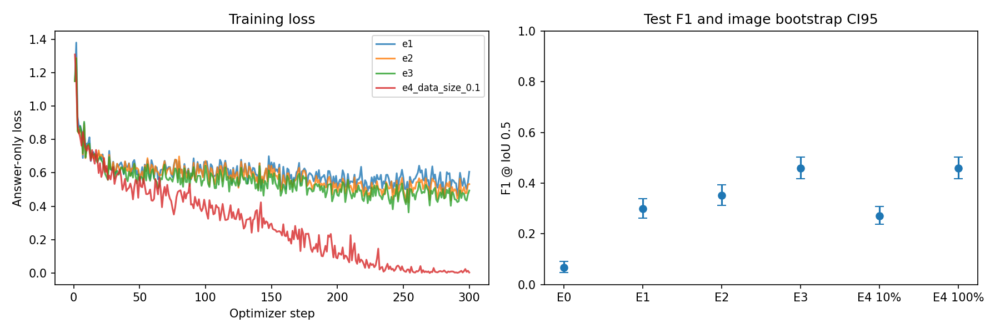
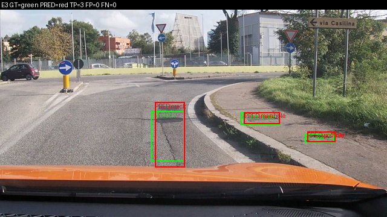
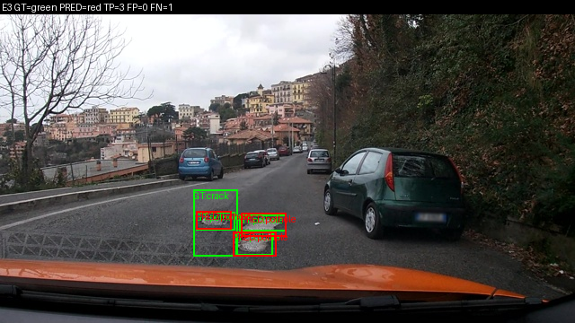
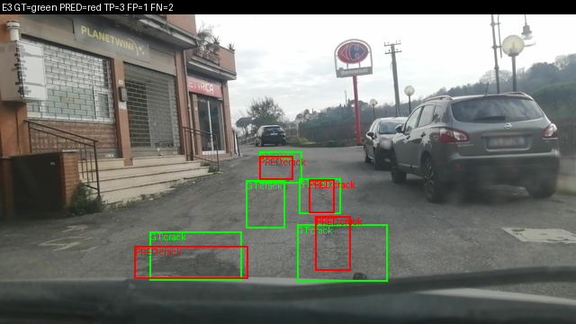
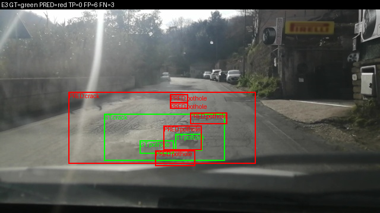
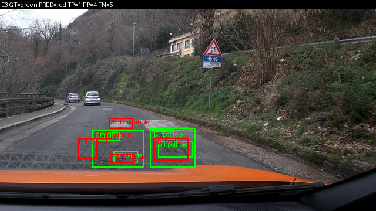
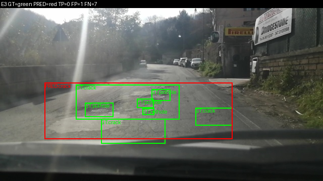

Họ tên: Đoàn Quang Thắng — 2A202602395
`dataset_version`: d10-21e4070301

Thực thi trên Kaggle, GPU Tesla T4; code soạn ở local. Mọi số dưới đây lấy từ artifact thật.
QLoRA NF4; visual và lm_head không lượng tử hoá. Batch 1 × accum 8; 300 optimizer steps,
seed 42, lr 2e-4, warmup 5%, cosine, giới hạn generation 512 token chung cho mọi setup.
Khác đề: Kaggle thay Colab; microbatch 1/accum 8 thay 2/4; cap 512 thay 256 để có chỗ cho nhiều box.

## Bảng tổng hợp

| Mã | Setup | Tham số train | VRAM GB | Phút train | F1 | CI95 | FP/ảnh | pothole F1 | crack F1 | manhole F1 |
|---|---|---:|---:|---:|---:|---|---:|---:|---:|---:|
| e0 | Zero-shot | 0 | — | — | 0.0678 | 0.0481–0.0920 | 1.6977 | 0.1429 | 0.0085 | 0.1712 |
| e1 | LoRA LLM | 33030144 | 5.1029 | 49.1485 | 0.2989 | 0.2615–0.3377 | 0.9807 | 0.2049 | 0.2133 | 0.5543 |
| e2 | LLM + projector | 142135296 | 6.7613 | 50.0354 | 0.3525 | 0.3121–0.3931 | 0.9357 | 0.1624 | 0.2882 | 0.6111 |
| e3 | LLM + projector + LoRA ViT | 148426752 | 6.8974 | 59.3199 | 0.4596 | 0.4163–0.5029 | 0.7331 | 0.3267 | 0.3865 | 0.6969 |
| e4_data_size_0.1 | E3, 10% train | 148426752 | 6.7840 | 58.3040 | 0.2715 | 0.2388–0.3070 | 1.8103 | 0.1954 | 0.1927 | 0.5347 |
| e4_data_size_1.0 | E3, 100% train (tái dùng) | 148426752 | 6.8974 | 59.3199 | 0.4596 | 0.4163–0.5029 | 0.7331 | 0.3267 | 0.3865 | 0.6969 |



E0 không train nên không có thời gian train/VRAM train. E1 parse_valid_rate=0.9968;
F1_E1 − F1_E0=0.2310. Đạt cả hai điều kiện rubric: parse ≥0,95 và mức tăng F1 ≥0,10.

### Câu 1 — Kiến trúc và khối được cập nhật
Đếm trọng số chưa nén từ shape của Params4bit: {"language_model": 4022468096, "vision_backbone": 306242560, "projector": 109105152, "other": 0, "total": 4437815808}.
Language model gồm embedding dùng chung với lm_head; vision_backbone không gồm projector.
E1 chỉ cập nhật LoRA trên 252 module LLM; E2 thêm toàn bộ merger/deepstack merger;
E3 thêm 96 module ViT, tổng 348. Danh sách exact target/param ở report/training/eN/run.json.

### Câu 2 — E0 và lỗi thường gặp
parse_valid_rate=0.8617; hai nhóm lỗi có số ảnh lớn nhất: [('images_with_fn', 291), ('images_with_fp', 222)].
Các nhóm có thể trùng nhau trong cùng ảnh. Đây là TP/FP/FN từ matching cùng lớp IoU≥0,5,
không suy đoán nguyên nhân chỉ từ JSON. Ví dụ output thô:
```text
[{"label": "manhole", "bbox_2d": [770, 640, 843, 687]}, {"label": "manhole", "bbox_2d": [909, 786, 1000, 824]}]
```

### Câu 3 — Thang toạ độ
E1 đúng norm1000 F1=0.2989; cùng raw chấm nhầm pixel F1=0.0000.
Chẩn đoán thực hiện sau khi khoá kết quả chính, ở report/diagnostics/e1-wrong-scale.json.
Ảnh 640×360: x_pixel=x_norm×640/1000, y_pixel=y_norm×360/1000.
Sai quy ước làm box lệch vị trí/kích thước nên IoU giảm dù JSON có thể hợp lệ.

### Câu 4 — Mask loss
Kiểm tra prompt là prefix full chat; token prompt/ảnh và padding có label −100.
Ví dụ có 220 token ảnh; 250 token được học.
Chuỗi supervised thực tế ở encoding-audit.json, gồm JSON đáp án và token kết thúc.
Chỉ học đáp án để loss tối ưu nhiệm vụ grounding, tránh bị chi phối bởi prompt cố định.
Không chạy ablation mask sai; ảnh hưởng nếu học prompt là giải thích cơ chế, không phải kết quả đo.

### Câu 5 — Projector và precision
Audit khẳng định visual/lm_head không là Linear4bit; chỉ 252 linear LLM lượng tử hoá.
Transformers 5.19 cần skip prefix đầy đủ `model.visual`; dùng `visual` như pseudo code đã
không loại trừ các linear ViT trong lần preflight, nên mã sinh viên sửa theo tên cây module thật.
Projector train ở fp32 để giữ cập nhật/gradient ổn định với GradScaler; forward dùng autocast fp16.
Trọng số NF4 đóng băng không thể được cập nhật đầy đủ như weight fp32; LoRA học phần bù riêng.
Adapter và projector.pt lưu riêng; reload vào base mới và kiểm tra hash tensor projector.
Đây là lựa chọn precision của thí nghiệm, không khẳng định mọi bài toán bắt buộc dùng fp32.

### Câu 6 — Split theo phiên quay
Số liệu thực: {"train": {"images": 1422, "boxes": {"pothole": 1074, "crack": 1750, "manhole": 691}}, "val": {"images": 276, "boxes": {"pothole": 66, "crack": 470, "manhole": 103}}, "test": {"images": 311, "boxes": {"pothole": 121, "crack": 299, "manhole": 163}}}.
Session train/val/test không giao nhau. Frame liền kề gần giống nhau; random split có thể đưa
cùng cảnh vào cả train/test và đánh giá khả năng nhớ cảnh thay vì tổng quát hoá.
Không chạy random split để lấy một con số F1 cao giả; không tuyên bố mức tăng khi chưa đo.

### Câu 7 — So sánh E1/E2/E3
Bảng trên là so sánh cùng base/seed/budget, khởi tạo độc lập, không train nối các setup.
Setup chọn theo val: E3; validation F1: {'E1': 0.21447721179624665, 'E2': 0.2998204667863555, 'E3': 0.351131221719457}.
Chênh lệch test E2−E1=0.0536,
E3−E2=0.1071.
Cần cân nhắc mức tăng F1 so với VRAM/thời gian trong bảng; nhiều tham số train hơn không bảo đảm F1 cao hơn.

### Câu 8 — 311 ảnh và khoảng tin cậy
Độ rộng CI95 bootstrap của E0–E3: {'e0': '0.0439', 'e1': '0.0762', 'e2': '0.0810', 'e3': '0.0865'}.
Scorer bootstrap 1000 lần theo ảnh; frame cùng phiên có tương quan nên CI này có thể quá hẹp
so với độ bất định giữa các phiên. Chưa chạy nhiều seed train nên CI không bao quát ngẫu nhiên của train.
CI hai setup chồng lấn không phải kiểm định khác biệt; không kết luận chắc chắn từ một chênh lệch nhỏ.

### Câu 9 — Lỗi theo lớp và ảnh
Ở setup E3, lớp F1 thấp nhất là pothole, F1=0.3267.
Kích thước box test đo được: {'pothole': {'n_boxes': 121, 'median_area_percent': 0.41927008680000005}, 'crack': {'n_boxes': 299, 'median_area_percent': 1.9813205034999999}, 'manhole': {'n_boxes': 163, 'median_area_percent': 0.6688347743}}.
Box nhỏ, phân bố số mẫu và ngữ nghĩa có thể góp phần gây lỗi; đây là giả thuyết, chưa phải phân tích nhân quả.
Sáu hình bên dưới có GT xanh/dự đoán đỏ và TP/FP/FN; ba ảnh nhiều TP và ba ảnh nhiều lỗi.



`vlcsnap-2025-02-18-23h10m48s405`: TP=3, FP=0, FN=0; JSON hợp lệ=True. Xanh: GT; đỏ: dự đoán.



`vlcsnap-2025-02-19-17h04m49s140`: TP=3, FP=0, FN=1; JSON hợp lệ=True. Xanh: GT; đỏ: dự đoán.



`vlcsnap-2025-02-18-23h24m36s429`: TP=3, FP=1, FN=2; JSON hợp lệ=True. Xanh: GT; đỏ: dự đoán.



`vlcsnap-2025-02-18-23h30m29s418`: TP=0, FP=6, FN=3; JSON hợp lệ=True. Xanh: GT; đỏ: dự đoán.



`vlcsnap-2025-02-19-17h03m02s980`: TP=1, FP=4, FN=5; JSON hợp lệ=True. Xanh: GT; đỏ: dự đoán.



`vlcsnap-2025-02-18-23h30m28s990`: TP=0, FP=1, FN=7; JSON hợp lệ=True. Xanh: GT; đỏ: dự đoán.


### Câu 10 — E4
Biến duy nhất: train_fraction, 10% (142 ảnh seed 42) và 100% (1422 ảnh).
Setup nền E3 được chọn bằng val; bản 100% tái dùng predictions gốc và chấm lại tên E4.
F1_10%=0.2715, F1_100%=0.4596;
CI95 tương ứng [0.23876197494473106, 0.30698388334612436] và [0.4163498098859315, 0.5028901734104045].
Cùng 300 optimizer steps nghĩa là subset 10% bị lặp nhiều lần hơn; đây là so sánh dưới cùng
ngân sách bước tối ưu, không phải cùng số epoch. F1 tăng 0,1881 khi dùng đủ dữ liệu;
CI95 hai cấu hình không chồng lấn trong phép bootstrap theo ảnh này.
Loss của bản 10% xuống gần 0 nhưng F1 thấp hơn bản 100%, phù hợp với giả thuyết
học quá sát subset nhỏ; một seed và CI theo ảnh chưa đủ xác nhận nguyên nhân.
Kết luận giới hạn bởi test nhỏ, tương quan session và một seed.

## Nhìn lại
Đã hoàn thành E0–E4 bằng số thật. Chưa chạy E5 GRPO, không nhận bonus cho phần này.
Nhãn gốc có box suy biến (width/height≤0): {'train': 1, 'val': 0, 'test': 0}.
Chỉ bỏ các box đó khỏi đáp án SFT; split và ground truth scorer không đổi.
Box có kích thước dương nhưng bị làm tròn mất chiều được giữ ít nhất 1 đơn vị trên thang 1000.
Vì vậy một target train không thể hoàn toàn trùng annotation suy biến; không bịa chiều box gốc.
Nguồn/scorer/test của đề giữ nguyên. Version 7 chạy bằng payload không chứa .git nên checker
có WARN về Git; kiểm tra bản GitHub thật được ghi riêng trong KAGGLE_STATUS.md.
Nhật ký train và cấu hình đã xuất sang report/training/; checkpoint và raw predictions
vẫn nằm trong output version 7 trên Kaggle, không đưa trọng số/dữ liệu vào Git.
Test template REPORT yêu cầu chuỗi placeholder, xung đột với báo cáo hoàn chỉnh: chạy nguyên bộ test
trước khi điền report; regression cuối deselect rõ duy nhất test template, không sửa tests.
